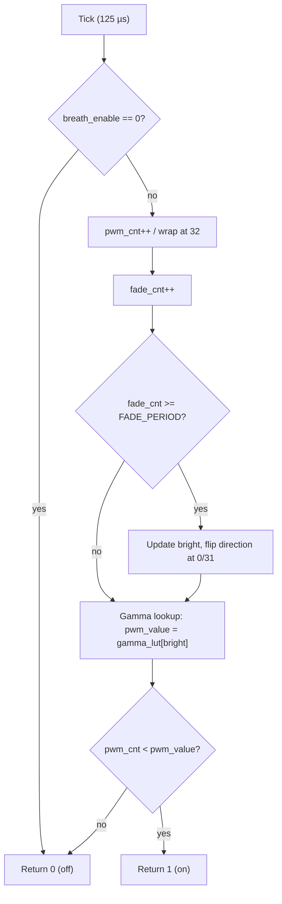
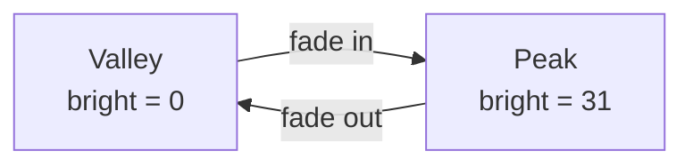
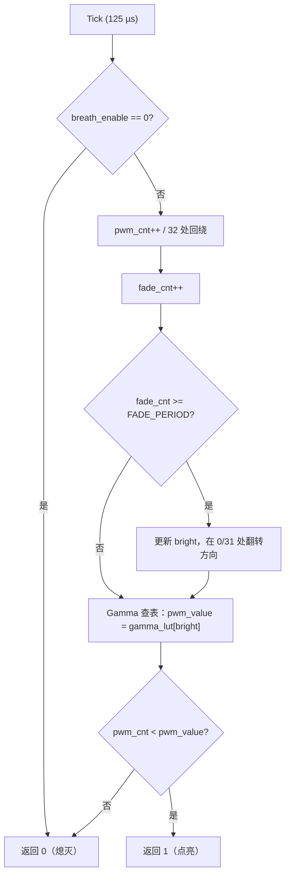
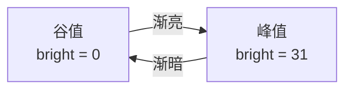

<div align="center">

# BreathLed

**A hardware-independent, tick-driven breathing-LED driver in plain C.**

**纯 C 实现的、硬件无关的、定时器驱动的呼吸灯模块。**

[](https://opensource.org/licenses/MIT)
[](https://en.wikipedia.org/wiki/C_(language))
[](https://en.wikipedia.org/wiki/Microcontroller)

[English](#english) · [中文](#chinese)

</div>

---

<a id="english"></a>

## English

### Overview

`BreathLed` generates a smooth, human-eye-friendly breathing (fade-in / fade-out) LED waveform. It is a **pure algorithmic module**: it owns no peripheral registers and touches no GPIO. Instead it returns a single logic level per call, and the application decides how to drive the hardware.

**Key design principle — zero hardware coupling:**
The module keeps all of its state in file-scope `static` variables. Nothing is exposed, nothing is passed in, and nothing must be cleaned up. You call it, it tells you "LED on" or "LED off", and you write that to a pin.

| Property | Value |
| --- | --- |
| Tick period | 125 µs (fixed, must be honored exactly) |
| PWM resolution | 32 levels |
| PWM frequency | 250 Hz (32 × 125 µs = 4 ms) |
| Brightness mapping | 32-entry Gamma correction LUT |
| Breathing period | 2.40 s @ `BREATH_LED_FADE_PERIOD = 300` |
| RAM footprint | 6 bytes of static state |
| ROM footprint | 32-byte LUT + ~200 bytes of code |
| Dependencies | None — no HAL, no RTOS, no dynamic memory, no floating point |
| C standard | C89-compatible (declarations at top of block) |

### Why not drive the GPIO directly?

Because the moment a module owns a pin, it can only be used with that pin. A LED driver that returns a *level* can drive a GPIO, a PWM peripheral, a shift register, a MOSFET, an LED bar graph, or a 7-segment COM/SEG matrix — the application layer decides. This keeps the module portable across every project you copy it into, which is exactly what you want from a drop-in utility.

### Features

- **Fully encapsulated** — all state is `static` inside `BreathLed.c`; the header exposes three functions and nothing else.
- **Gamma corrected** — a 32-entry LUT compensates the non-linear response of the human eye, so the fade *looks* linear instead of *being* linear.
- **Deterministic** — the output depends only on the number of times `BreathLed_Process()` has been called. No timers, no interrupts, no internal delay loops.
- **ISR-friendly** — bounded, constant-time execution; safe to call from a timer interrupt.
- **Zero allocation** — no `malloc`, no `static` init hooks, nothing to deinitialize.

### API

```c
void BreathLed_Init(void);
void BreathLed_Enable(unsigned char enable);
unsigned char BreathLed_Process(void);
```

#### `BreathLed_Init(void)`

Resets every internal variable (`breath_enable`, `pwm_cnt`, `bright`, `direction`, `fade_cnt`) to its power-on state. Call it once at boot, before enabling the effect.

#### `BreathLed_Enable(unsigned char enable)`

Enables or disables the breathing effect.

- `enable = 1` → effect runs.
- `enable = 0` → effect stops **and** the state is reset to the beginning of the cycle (dark, ready to fade in again).

> **Note:** calling `BreathLed_Enable(1)` when the effect is already enabled is harmless and does **not** reset the cycle. Only `BreathLed_Enable(0)` resets it. This is what makes it safe to call `Enable(1)` on every tick, as the demo does.

#### `BreathLed_Process(void)`

Advances the state machine by one 125 µs tick and returns the current PWM output level.

- Returns `1` → the LED should be **on** during this tick.
- Returns `0` → the LED should be **off** during this tick.

**Must be called exactly every 125 µs.** The module has no internal time base, so the tick rate *is* the time base. Calling it faster or slower scales the whole waveform proportionally.

### Integration

#### 1. Add the files

Copy `BreathLed.c` and `BreathLed.h` into your project and add `BreathLed.c` to the build. No other setup, no configuration file, no header path to fix beyond the include path.

#### 2. Set up a 125 µs tick

Any periodic interrupt at 125 µs works — a hardware timer, a SysTick, a scheduler tick. A typical 8 MHz MCU with a 1 MHz timer clock needs a reload of `125 - 1`.

```c
/* Example: 1 MHz timer, reload = 124 -> 125 us period */
TIM_PSC   = 0;
TIM_ARR   = 124;
```

#### 3. Drive the output

```c
#include "BreathLed.h"

/* Called from the 125 us tick ISR */
void LED_Breath_Process(void)
{
    unsigned char led_on;

    BreathLed_Enable(1);            /* start the effect */
    led_on = BreathLed_Process();   /* advance one tick */

    if (led_on)
    {
        /* ON */
    }
    else
    {
        /* OFF */
    }
}

int main(void)
{
    BreathLed_Init();

    while (1)
    {
    }
}
```

### Timing reference

`BREATH_LED_FADE_PERIOD` controls how long the brightness stays on one step. The formula is:

```
step time   = BREATH_LED_FADE_PERIOD × 125 µs
full cycle  = 64 × step time
```

A full cycle is 64 ticks: 32 ticks to fade in from 0 to 31, and 32 ticks to fade back out.

| `BREATH_LED_FADE_PERIOD` | Step time | Full breathing cycle | Feel |
| --- | --- | --- | --- |
| 200 | 25.0 ms | 1.60 s | Fast, snappy |
| 300 *(default)* | 37.5 ms | 2.40 s | Calm |
| 400 | 50.0 ms | 3.20 s | Slower |
| 500 | 62.5 ms | 4.00 s | Slow |
| 600 | 75.0 ms | 4.80 s | Very slow |
| 800 | 100.0 ms | 6.40 s | Ambient |
| 1000 | 125.0 ms | 8.00 s | Breathing / meditation |

> **Note on the legacy table:** older revisions of `BreathLed.h` quoted 2.33 s for a period of 300. That figure counts only the 62 *brightness-changing* steps and omits the two extra ticks consumed while the direction flag flips at the peak and at the valley. The real wall-clock cycle is 64 ticks (2.40 s at 300).

### Tuning

#### Slower or faster breathing

Change the macro in `BreathLed.h`:

```c
#define BREATH_LED_FADE_PERIOD 300   /* 300 × 125 us = 37.5 ms per step */
```

A compile-time constant keeps the hot path free of any division or multiply.

#### Brighter or dimmer peak

The Gamma LUT is the brightness curve:

```c
static const unsigned char gamma_lut[BREATH_LED_PWM_MAX] = {
    0, 1, 1, 2, 2, 2, 3, 3,
    4, 4, 4, 5, 5, 6, 6, 7,
    8, 9, 10, 12, 13, 14, 16, 17,
    19, 20, 22, 24, 25, 27, 29, 31};
```

- **Raise the tail** (values near index 31) to make the fade-in spend more time in the bright region.
- **Lower the tail** to make the LED look dimmer overall without changing the period.
- **Raise the head** (values near index 0) to keep the LED visibly lit for longer at the bottom of the cycle.

> **Heads-up on peak brightness:** the largest LUT entry is 31, so the maximum duty cycle is `31/32 ≈ 96.9 %`. The LED never reaches 100 % on. If you need true full-on, either add a 33rd entry with the value 32 and raise `BREATH_LED_PWM_MAX` to 33, or change the comparison in `BreathLed_Process()` from `pwm_cnt < pwm_value` to `pwm_cnt <= pwm_value` and keep the peak at 32.

#### Different PWM frequency

`BREATH_LED_PWM_MAX` sets the resolution, and the frequency follows automatically:

```
f_PWM = 1 / (BREATH_LED_PWM_MAX × 125 µs)
```

| `BREATH_LED_PWM_MAX` | Resolution | Frequency |
| --- | --- | --- |
| 16 | 16 levels | 500 Hz |
| 32 *(default)* | 32 levels | 250 Hz |
| 64 | 64 levels | 125 Hz |

Keep in mind that changing the maximum also changes the length of the brightness table, so the LUT must be updated to match.

### Internal state machine





### Porting notes

- **Tick period.** If your base tick is not 125 µs, rescale `BREATH_LED_FADE_PERIOD` by the same factor (`new_period = old_period × new_tick / 125 µs`) so the breathing duration stays the same. The PWM frequency follows the tick, so 250 Hz is only guaranteed at 125 µs.
- **Interrupt context.** The state variables are plain `static`, not `volatile`. That is correct when `BreathLed_Process()` is called from a single context (one ISR, or one task). If you call it from an ISR *and* from a task, declare the state `volatile` and confine all calls to one context — the module is not re-entrant.
- **Multiple LEDs.** The state is module-global, so one instance drives one LED. For N independent LEDs, compile the module N times under different names (`-DBreathLed_Init=LED1_Init`, etc.) or turn the file-static state into a caller-supplied context.
- **`volatile` on the output.** If the GPIO write happens in a different context than the tick, make the shared flag `volatile`.

### FAQ

**Q: The LED is dimmer than expected.**
The maximum duty cycle is 96.9 % by design (the LUT peaks at 31). See *Brighter or dimmer peak* above.

**Q: The breathing rhythm drifts.**
The module has no internal time base, so the rhythm is exactly the tick rate. If it drifts, the tick is not exactly 125 µs — usually a reload value off by one, or the ISR is being delayed by other work.

**Q: Can I call `BreathLed_Process()` only when I need it?**
Yes, but the waveform then advances in larger steps. The module expects one call per tick for a smooth result.

**Q: Does it work with a hardware PWM peripheral?**
Yes. The returned level is a plain on/off decision per tick. If your MCU has a hardware PWM channel, drive the duty cycle from the same `bright` value instead of calling the tick function at PWM rate.

**Q: `void main(void)` in the demo — is that right?**
Not strictly. `main` should return `int` in hosted C (`int main(void)`). Many embedded toolchains accept `void main(void)`, but the portable form is `int main(void)`. The demo in this repository uses the portable form.

### License

MIT — see [LICENSE](LICENSE).

---

<a id="chinese"></a>

## 中文

### 概述

`BreathLed` 用于生成平滑、符合人眼视觉规律的呼吸灯（渐亮 / 渐暗）波形。这是一个**纯算法模块**：它不持有任何外设寄存器，不直接操作 GPIO，只在每次调用时返回一个电平，由应用层决定如何驱动硬件。

**核心设计原则 —— 硬件零耦合：**
模块的所有状态都保存在文件作用域的 `static` 变量中。不对外暴露任何符号，不需要外部传入参数，也没有需要清理的资源。你调用它，它告诉你"灯亮"还是"灯灭"，剩下的写引脚的工作交给应用层。

| 特性 | 取值 |
| --- | --- |
| 定时基 | 125 µs（固定，必须严格遵守） |
| PWM 分辨率 | 32 级 |
| PWM 频率 | 250 Hz（32 × 125 µs = 4 ms） |
| 亮度映射 | 32 级 Gamma 校正查找表 |
| 呼吸周期 | 2.40 s @ `BREATH_LED_FADE_PERIOD = 300` |
| RAM 占用 | 6 字节静态状态 |
| ROM 占用 | 32 字节查找表 + 约 200 字节代码 |
| 依赖 | 无 —— 不依赖 HAL、RTOS、动态内存、浮点运算 |
| C 标准 | 兼容 C89（变量声明置于块首） |

### 为什么不直接操作 GPIO？

因为一旦模块持有引脚，它就只能配给那个引脚用。而一个只返回**电平**的 LED 驱动，既可以驱动 GPIO，也可以驱动 PWM 外设、移位寄存器、MOSFET、LED 灯条，甚至 7 段数码管的 COM/SEG 矩阵 —— 由应用层自己决定。这样模块复制到任何工程里都能直接用，这正是"即插即用工具模块"应有的样子。

### 特性

- **完全封装** —— 所有状态都是 `BreathLed.c` 内的 `static` 变量；头文件只暴露三个函数。
- **Gamma 校正** —— 32 级查找表补偿人眼对亮度的非线性响应，让渐变"看起来"线性，而不是"算出来"线性。
- **确定性** —— 输出只取决于 `BreathLed_Process()` 被调用了多少次。不含定时器、不含中断、不含内部延时循环。
- **中断友好** —— 执行时间有固定上界，可在定时器中断中安全调用。
- **零动态分配** —— 无 `malloc`，无初始化钩子，无需反初始化。

### 接口说明

```c
void BreathLed_Init(void);
void BreathLed_Enable(unsigned char enable);
unsigned char BreathLed_Process(void);
```

#### `BreathLed_Init(void)`

复位全部内部变量（`breath_enable`、`pwm_cnt`、`bright`、`direction`、`fade_cnt`）至上电状态。在启用效果之前于启动阶段调用一次即可。

#### `BreathLed_Enable(unsigned char enable)`

开启或关闭呼吸效果。

- `enable = 1` → 运行效果。
- `enable = 0` → 停止效果，**并且**把状态复位到周期起点（从最暗开始重新渐亮）。

> **说明：** 在已使能的情况下再次调用 `BreathLed_Enable(1)` 是无害的，**不会**重置当前周期。只有 `BreathLed_Enable(0)` 才会复位。正因如此，在每个 tick 里调用 `Enable(1)` 才是安全的 —— 示例代码就是这么写的。

#### `BreathLed_Process(void)`

将状态机推进一个 125 µs tick，并返回当前 PWM 输出电平。

- 返回 `1` → 本 tick 内 LED 应**点亮**。
- 返回 `0` → 本 tick 内 LED 应**熄灭**。

**必须严格每 125 µs 调用一次。** 模块内部没有时间基准，tick 周期本身就是时基。调用过快或过慢，整个波形会按比例缩放。

### 移植步骤

#### 1. 添加文件

把 `BreathLed.c` 和 `BreathLed.h` 拷入工程，并将 `BreathLed.c` 加入编译。除包含路径外无需任何额外配置。

#### 2. 配置 125 µs 定时基

任意 125 µs 周期的中断都可以 —— 硬件定时器、SysTick 或调度器 tick 均可。典型场景：8 MHz MCU 配置 1 MHz 定时器时钟时，重装值为 `125 - 1`。

```c
/* 示例：1 MHz 定时器，ARR = 124 -> 125 us 周期 */
TIM_PSC   = 0;
TIM_ARR   = 124;
```

#### 3. 驱动输出

```c
#include "BreathLed.h"

/* 在 125 us tick 中断中调用 */
void LED_Breath_Process(void)
{
    unsigned char led_on;

    BreathLed_Enable(1);            /* 启动效果 */
    led_on = BreathLed_Process();   /* 推进一个 tick */

    if (led_on)
    {
        /* 点亮 */
    }
    else
    {
        /* 熄灭 */
    }
}

int main(void)
{
    BreathLed_Init();

    while (1)
    {
    }
}
```

### 时序参数参考

`BREATH_LED_FADE_PERIOD` 决定亮度在每一级台阶上停留多久，计算公式：

```
每级时间 = BREATH_LED_FADE_PERIOD × 125 µs
完整周期 = 64 × 每级时间
```

完整周期为 64 个 tick：从 0 渐亮到 31 用 32 个 tick，再渐暗回 0 用 32 个 tick。

| `BREATH_LED_FADE_PERIOD` | 每级时间 | 完整呼吸周期 | 观感 |
| --- | --- | --- | --- |
| 200 | 25.0 ms | 1.60 s | 快速、灵敏 |
| 300 *(默认)* | 37.5 ms | 2.40 s | 平稳 |
| 400 | 50.0 ms | 3.20 s | 偏慢 |
| 500 | 62.5 ms | 4.00 s | 慢 |
| 600 | 75.0 ms | 4.80 s | 很慢 |
| 800 | 100.0 ms | 6.40 s | 氛围灯 |
| 1000 | 125.0 ms | 8.00 s | 呼吸 / 冥想节奏 |

> **关于旧版参数表的说明：** 早期版本的 `BreathLed.h` 在周期为 300 时标注的是 2.33 s。该数值只统计了 62 个"亮度发生变化的"台阶，漏掉了波峰和波谷处翻转方向标志所消耗的 2 个 tick。真实墙钟周期是 64 个 tick（周期值 300 时为 2.40 s）。

### 参数调整

#### 调整呼吸快慢

修改 `BreathLed.h` 中的宏定义：

```c
#define BREATH_LED_FADE_PERIOD 300   /* 300 × 125 us = 37.5 ms 每级 */
```

编译期常量可保证热路径上不出现任何除法或乘法运算。

#### 调整亮度上限 / 整体明暗

Gamma 查找表就是亮度曲线：

```c
static const unsigned char gamma_lut[BREATH_LED_PWM_MAX] = {
    0, 1, 1, 2, 2, 2, 3, 3,
    4, 4, 4, 5, 5, 6, 6, 7,
    8, 9, 10, 12, 13, 14, 16, 17,
    19, 20, 22, 24, 25, 27, 29, 31};
```

- **抬高表尾**（索引接近 31 的值）→ 渐亮过程在亮区停留更久。
- **压低表尾** → 不改变周期，但整体看起来更暗。
- **抬高表头**（索引接近 0 的值）→ 谷底阶段保持可见点亮的时间更长。

> **峰值亮度提示：** 表中最大值为 31，因此最大占空比为 `31/32 ≈ 96.9 %`，LED 永远不会达到 100 % 全亮。若确实需要全亮，可以增加第 33 个表项（值为 32）并把 `BREATH_LED_PWM_MAX` 改为 33；或者把 `BreathLed_Process()` 中的比较由 `pwm_cnt < pwm_value` 改为 `pwm_cnt <= pwm_value`，同时把峰值保持为 32。

#### 调整 PWM 频率

`BREATH_LED_PWM_MAX` 决定分辨率，频率自动跟随：

```
f_PWM = 1 / (BREATH_LED_PWM_MAX × 125 µs)
```

| `BREATH_LED_PWM_MAX` | 分辨率 | 频率 |
| --- | --- | --- |
| 16 | 16 级 | 500 Hz |
| 32 *(默认)* | 32 级 | 250 Hz |
| 64 | 64 级 | 125 Hz |

注意修改最大值会同时改变亮度表长度，查表数据需同步更新。

### 内部状态机





### 移植注意事项

- **tick 周期。** 若基础 tick 不是 125 µs，请按同比例缩放 `BREATH_LED_FADE_PERIOD`（`新周期值 = 旧周期值 × 新 tick / 125 µs`），以保持呼吸时长不变。PWM 频率跟随 tick，只有在 125 µs 时才保证为 250 Hz。
- **中断上下文。** 状态变量是普通 `static` 而非 `volatile`。当 `BreathLed_Process()` 只在单一上下文（一个中断或一个任务）中调用时，这是正确做法。若同时在中断和任务中调用，请把状态声明为 `volatile` 并把调用收敛到单一上下文 —— 本模块不可重入。
- **多路 LED。** 状态是模块级全局变量，一个实例只能驱动一颗 LED。若需要 N 路独立呼吸灯，可用不同宏名多次编译本文件（`-DBreathLed_Init=LED1_Init` 等），或把文件级静态状态改为调用方传入的上下文结构体。
- **输出标志的可见性。** 若 GPIO 写操作与 tick 不在同一上下文，共享标志需声明为 `volatile`。

### 常见问题

**Q：LED 比预期暗。**
最大占空比按设计就是 96.9 %（表值峰值为 31）。参见上文"调整亮度上限 / 整体明暗"。

**Q：呼吸节奏有漂移。**
模块没有内部时基，节奏完全由 tick 决定。若出现漂移，说明 tick 并非严格 125 µs —— 通常是重装值差了 1，或者中断被其他任务长时间占用。

**Q：可以只在需要的时候调用 `BreathLed_Process()` 吗？**
可以，但波形会以更大的步进推进。要得到平滑效果，模块期望每个 tick 调用一次。

**Q：可以配合硬件 PWM 外设使用吗？**
可以。返回的只是一个逐 tick 的开关决策。若 MCU 有硬件 PWM 通道，可以直接用同一个 `bright` 值去设置占空比，而不必以 PWM 频率调用该函数。

**Q：示例代码里的 `void main(void)` 规范吗？**
严格说不规范。宿主 C 中 `main` 应返回 `int`（即 `int main(void)`）。不少嵌入式工具链接受 `void main(void)`，但可移植写法是 `int main(void)`。本仓库示例采用的是可移植写法。

### 许可证

MIT —— 详见 [LICENSE](LICENSE)。

---

## 文件清单 / File list

```
BreathLed/
├── BreathLed.c        # Module implementation / 模块实现
├── BreathLed.h        # Public API and configuration / 公共接口与配置
├── BreathLed_demo.c   # Usage example / 使用示例
├── README.md          # This document / 本文档
└── LICENSE            # MIT License / MIT 许可证
```

## 许可与贡献 / License & contributing

Issues and pull requests are welcome. Please keep the module free of hardware dependencies so it stays portable across projects.

欢迎提交 Issue 与 Pull Request。请保持模块不引入任何硬件依赖，以确保它在各项目间可移植。
